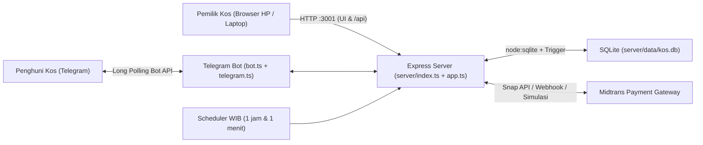
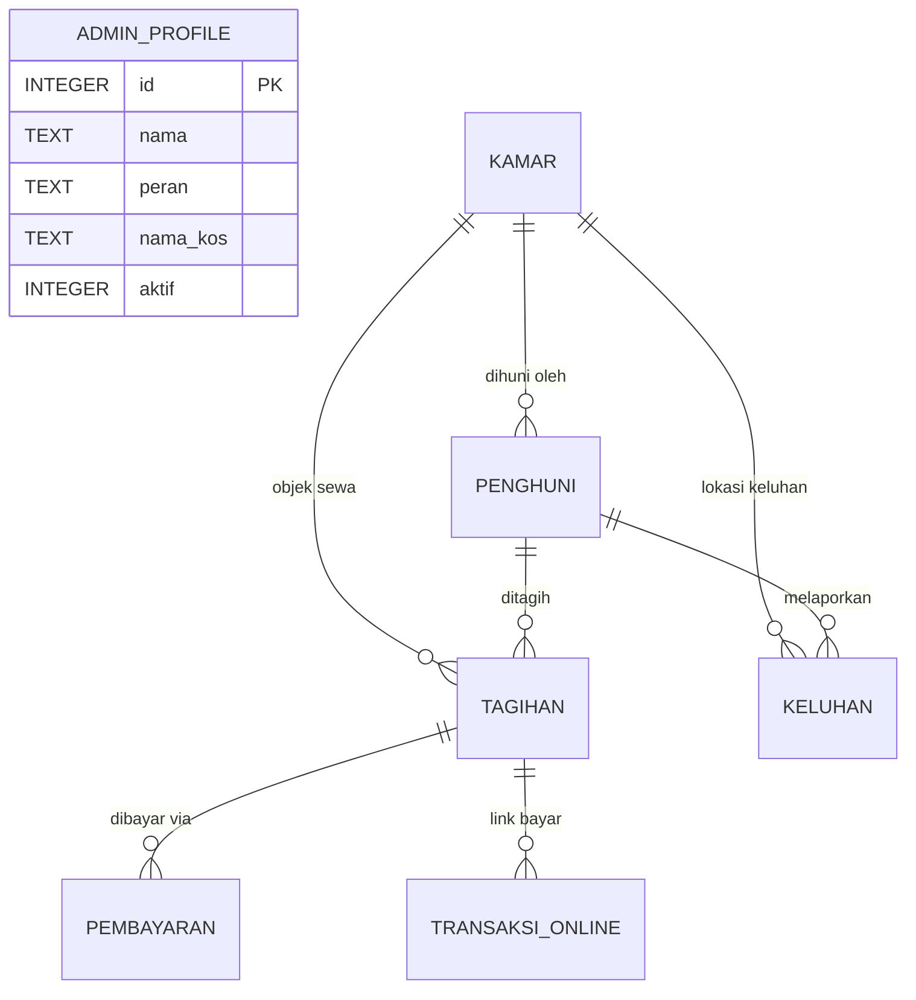

# Manajemen Kos Gopi — State Aplikasi & Product Requirements Document (PRD)

> **Status Dokumen:** Aktif (Branch `coba` tersinkron dengan `main` + Integrasi Telegram Keluhan 2 Arah)  
> **Tanggal Pembaruan:** 19 November 2026  
> **Pemilik / Klien:** Gopi (Pemilik Kos Gopi — Kelompok 2 MPTI, Universitas Brawijaya)  
> **Lingkungan Aktif Pengembangan:** Localhost (branch `coba`); Docker server (`192.168.100.46:3001`) masih menjalankan rilis `4c195ac` dari `main`

---

## Daftar Isi

1. [Bagian I — State Aplikasi Sekarang (Current State)](#bagian-i--state-aplikasi-sekarang-current-state)
   - [1.1 Ringkasan Eksekutif & Tech Stack](#11-ringkasan-eksekutif--tech-stack)
   - [1.2 Arsitektur & Alur Sistem](#12-arsitektur--alur-sistem)
   - [1.3 Status Fitur & Halaman Web Saat Ini](#13-status-fitur--halaman-web-saat-ini)
   - [1.4 Skema Database (SQLite + Migrasi 001–010)](#14-skema-database-sqlite--migrasi-001010)
   - [1.5 Daftar Endpoint API Saat Ini](#15-daftar-endpoint-api-saat-ini)
   - [1.6 Layanan Latar Belakang (Scheduler & Bot)](#16-layanan-latar-belakang-scheduler--bot)
   - [1.7 Pengujian & Status Deployment Docker](#17-pengujian--status-deployment-docker)
   - [1.8 Analisis Celah & Risiko Saat Ini (Gap Analysis)](#18-analisis-celah--risiko-saat-ini-gap-analysis)
2. [Bagian II — Product Requirements Document (PRD)](#bagian-ii--product-requirements-document-prd)
   - [2.1 Visi Produk & Measurable Organizational Value (MOV)](#21-visi-produk--measurable-organizational-value-mov)
   - [2.2 Persona Pengguna](#22-persona-pengguna)
   - [2.3 Kebutuhan Fungsional (Epics, User Stories & Spesifikasi)](#23-kebutuhan-fungsional-epics-user-stories--spesifikasi)
   - [2.4 Aturan Bisnis Inti (Business Rules)](#24-aturan-bisnis-inti-business-rules)
   - [2.5 Kebutuhan Non-Fungsional (NFR)](#25-kebutuhan-non-fungsional-nfr)
   - [2.6 Roadmap & Backlog Prioritas Berikutnya](#26-roadmap--backlog-prioritas-berikutnya)

---

# Bagian I — State Aplikasi Sekarang (Current State)

## 1.1 Ringkasan Eksekutif & Tech Stack

**Manajemen Kos Gopi** adalah aplikasi web + chatbot terintegrasi untuk mengelola operasional harian rumah kos (kamar, penghuni, tagihan/cicilan, keluhan fasilitas, pengingat jatuh tempo, dan pembayaran online). Pada kondisi terkini (`v0.2.0`), seluruh Epic utama **EP-01 s.d. EP-05** serta **revisi fleksibilitas harga & jangka sewa dari klien** telah diimplementasikan, dikemas ke dalam **Docker**, dan berjalan di server lokal/jaringan.

| Lapisan | Teknologi / Implementasi Aktual | File Referensi |
| :--- | :--- | :--- |
| **Frontend UI** | React `19.1.0`, TypeScript `~5.8.3`, Vite `7.1.7`, Tailwind CSS `v4` (`@tailwindcss/vite`), komponen **shadcn/ui** (`radix-ui`), ikon `lucide-react`, toast `sonner`, grafik `recharts` | [`package.json`](package.json), [`src/main.tsx`](src/main.tsx) |
| **Backend API** | Node.js (`>=22.13`, Docker memakai `node:22-slim` TypeScript strip-types), **Express `5.3.0`** | [`server/app.ts`](server/app.ts), [`server/index.ts`](server/index.ts) |
| **Database** | **SQLite** bawaan Node (`node:sqlite` / `DatabaseSync`) dengan migrasi SQL bernomor `001`–`010` + PRAGMA `foreign_keys = ON` & trigger integritas | [`server/db.ts`](server/db.ts), [`server/migrations/`](server/migrations) |
| **Chatbot** | **Telegram Bot API** native via `fetch` **long polling** (tanpa butuh domain/HTTPS webhook) | [`server/bot.ts`](server/bot.ts), [`server/telegram.ts`](server/telegram.ts) |
| **Pembayaran Online** | **Midtrans Snap** (Sandbox/Production via `MIDTRANS_SERVER_KEY`) dengan fallback otomatis ke **Mode Simulasi** bila key kosong | [`server/pembayaran-online.ts`](server/pembayaran-online.ts) |
| **Zona Waktu Bisnis** | `Asia/Jakarta` (WIB) untuk tanggal masuk, jatuh tempo, tagihan berjalan, dan scheduler | [`server/dates.ts`](server/dates.ts) |
| **Containerization** | Docker (`node:22-slim`) & Docker Compose dengan volume persisten `./server/data:/app/server/data` | [`Dockerfile`](Dockerfile), [`docker-compose.yml`](docker-compose.yml) |
| **Testing** | Node native test runner (`node --test`) untuk API & utilitas frontend | [`server/api.test.ts`](server/api.test.ts), [`src/lib/tren.test.ts`](src/lib/tren.test.ts) |

---

## 1.2 Arsitektur & Alur Sistem

Saat dijalankan dalam mode produksi (termasuk di Docker), **Express** bertindak sebagai proses tunggal yang melayani berkas statis frontend hasil build (`dist/`), REST API (`/api/*`), halaman simulasi pembayaran, penjadwal otomatis tiap jam/menit, dan polling Bot Telegram.

---

## 1.3 Status Fitur & Halaman Web Saat Ini

Antarmuka web dibagi menjadi **6 halaman** yang dapat diakses lewat sidebar ([`src/app-sidebar.tsx`](src/app-sidebar.tsx)) dan menu dropdown profil:

| Halaman | File | Fitur yang Sudah Jalan Saat Ini | Status |
| :--- | :--- | :--- | :--- |
| **Dashboard** | [`src/pages/Dashboard.tsx`](src/pages/Dashboard.tsx) | • Ringkasan KPI: total kamar, terisi/kosong, potensi & pendapatan sewa, rekap tagihan bulan berjalan, jumlah keluhan aktif. • Grafik okupansi & tren penghuni masuk 6 bulan ([`src/dashboard-charts.tsx`](src/dashboard-charts.tsx)). • Katalog cepat kamar + filter status & pencarian. • Form cepat registrasi penghuni baru dengan **pilihan jangka sewa (`Harian`, `Mingguan`, `Bulanan`, `Tahunan`), lama sewa, dan input manual nominal sewa (Rp)**. • Modal tambah kamar cepat dari dashboard. | Selesai |
| **Kamar** | [`src/pages/Kamar.tsx`](src/pages/Kamar.tsx) | • Daftar & filter kamar (`Semua`, `Kosong`, `Terisi`, pencarian nomor/penghuni). • Tambah, ubah, dan hapus kamar (dilindungi: kamar `Terisi` atau punya riwayat tagihan/keluhan tidak dapat dihapus). • **Revisi klien diterapkan:** Label preset `VIP / AC / Standar` sudah dihapus dari tampilan kartu, form, filter, dan migrasi DB (`010_hapus_tipe_kamar.sql`); nominal & jangka sewa ditentukan fleksibel oleh pemilik saat sewa/tagihan. | Selesai |
| **Penghuni** | [`src/pages/Penghuni.tsx`](src/pages/Penghuni.tsx) | • Registrasi penghuni baru ke kamar `Kosong` (otomatis mengubah status kamar jadi `Terisi` dan membuat tagihan awal dalam 1 transaksi). • Pengaturan **jangka sewa (`Harian`/`Mingguan`/`Bulanan`/`Tahunan`), durasi sewa, tanggal selesai otomatis, dan input manual `Nominal tagihan sewa (Rp)`**. • Fitur **Atur Sewa** (`PATCH /api/penghuni/:id/sewa`) untuk mengubah harga & durasi sewa penghuni aktif sekaligus menyinkronkan tagihan aktif. • Generate **Kode Hubung Bot Telegram (6 digit sekali pakai)** per penghuni. • Catat penghuni keluar (`PATCH /api/penghuni/:id/keluar`) + toggle tampilkan riwayat penghuni keluar. | Selesai |
| **Tagihan** | [`src/pages/Tagihan.tsx`](src/pages/Tagihan.tsx) | • Rekap tagihan per bulan (`total ditagihkan`, `pembayaran diterima`, `sisa`, daftar `Lunas`/`Belum Bayar`/`Dicicil`). • Tombol **Buat Tagihan** massal per periode + tombol **Input Tagihan & Jangka Sewa** manual (`POST /api/tagihan`). • Modal **Atur Nominal & Jangka Sewa** (`PATCH /api/tagihan/:id`) pada tagihan individual. • **Catat Bayar** penuh atau **cicilan** bertahap, **Undo/Batal** per transaksi atau 1 tagihan (tercatat sebagai `dibatalkan_at`, tidak hilang). • **Kuitansi** siap cetak/PDF dari browser. • **Pengingat jatuh tempo (`H-3`, `H-0`, `Terlambat`)** + tombol kirim pesan **WhatsApp** & salin **Link Bayar Online**. • Auto-refresh setiap 15 detik agar pembayaran via Bot Telegram langsung terupdate. | Selesai |
| **Keluhan** | [`src/pages/Keluhan.tsx`](src/pages/Keluhan.tsx) | • Khusus sisi **Admin / Pemilik Kos** (form input sisi penghuni & switcher mode sudah dihapus karena penghuni tidak mengakses web). • Rekap jumlah keluhan (`Total`, `Pending`, `Diproses`, `Selesai`), filter status, prioritas (`Rendah`, `Sedang`, `Tinggi`), dan pencarian. • Kartu informasi & salin format Bot Telegram `/keluhan`, serta **auto-refresh setiap 15 detik** saat tab aktif. • Pembaruan status berurutan (`Pending` → `Diproses` → `Selesai`, serta buka kembali ke `Diproses`) dengan catatan penanganan dan tanggal selesai, **otomatis mengirim notifikasi balik ke Telegram penghuni**. • **Integrasi Penghuni:** Penghuni mengirim laporan langsung dari Telegram lewat `/keluhan` berformat & memantau progresnya via `/statuskeluhan`. | Selesai (Khusus Admin + Telegram 2 arah) |
| **Profil Admin** | [`src/pages/Profil.tsx`](src/pages/Profil.tsx) | • CRUD penuh profil admin/pengelola (`nama`, `peran`, `email`, `no_hp`, `nama_kos`, `alamat_kos`, `avatar_url`) dan pengaktifan profil aktif yang tampil di sidebar dan kuitansi/bot. | Selesai |

---

## 1.4 Skema Database (SQLite + Migrasi `001`–`010`)

Database berada di `server/data/kos.db` (dapat diatur via `DB_PATH`). Migrasi dijalankan otomatis saat aplikasi start ([`server/db.ts`](server/db.ts)).

| Migrasi | Ringkasan Perubahan |
| :--- | :--- |
| `001_kamar_penghuni.sql` | Tabel `kamar` & `penghuni`, index `ux_penghuni_kamar_aktif` (single-occupancy), trigger status kamar otomatis (`Kosong` ↔ `Terisi`) & cegah hapus kamar terisi. |
| `002_admin_profile.sql` | Tabel `admin_profile` + seed default pemilik kos (`Gopi`, `Kos Gopi`). |
| `003_tagihan.sql` | Tabel `tagihan`, unique index `ux_tagihan_penghuni_bulan` (mencegah tagihan ganda pada bulan yang sama). |
| `004_pembayaran_cicilan.sql` | Tabel `pembayaran` (1 tagihan dapat memiliki banyak transaksi pembayaran/cicilan). |
| `005_perlindungan_pembayaran.sql` | Trigger `trg_tagihan_hapus_berbayar` & `trg_pembayaran_batas` untuk menjaga histori dan mencegah over-payment di level DB. |
| `006_keluhan.sql` | Tabel `keluhan` beserta status (`Pending`, `Diproses`, `Selesai`), kategori, prioritas, catatan penanganan, dan tanggal selesai. |
| `007_integritas_riwayat.sql` | Soft-cancel pembayaran (`dibatalkan_at`), trigger `trg_kamar_hapus_berkeluhan`, dan `ux_penghuni_no_hp_aktif`. |
| `008_chatbot_pembayaran_online.sql` | Kolom `chat_id` & `kode_hubung` pada `penghuni` (dengan unique index) + tabel `transaksi_online` (`midtrans` / `simulasi`). |
| `009_fleksibilitas_sewa.sql` | Dukungan sewa `Harian`, `Mingguan`, `Bulanan`, `Tahunan`: `periode_default` & tarif opsional di `kamar`; `periode_sewa`, `durasi_sewa`, `harga_sewa`, `tanggal_selesai_sewa` di `penghuni`; `periode_sewa` & `durasi_sewa` di `tagihan`. |
| `010_hapus_tipe_kamar.sql` | Membersihkan data lama `kamar.tipe` yang masih bertuliskan `'VIP'`, `'AC'`, `'Standar'` menjadi `periode_default`. |

---

## 1.5 Daftar Endpoint API Saat Ini

Seluruh endpoint terdefinisi di [`server/app.ts`](server/app.ts):

- **Ringkasan Dashboard:** `GET /api/ringkasan`
- **Profil Admin:** `GET /api/admin`, `GET /api/admin/aktif`, `POST /api/admin`, `PUT /api/admin/:id`, `PATCH /api/admin/:id/aktifkan`, `DELETE /api/admin/:id`
- **Kamar:** `GET /api/kamar`, `GET /api/kamar/:id`, `POST /api/kamar`, `PUT /api/kamar/:id`, `DELETE /api/kamar/:id`
- **Penghuni & Sewa:** `GET /api/penghuni`, `POST /api/penghuni`, `PATCH /api/penghuni/:id/sewa`, `PATCH /api/penghuni/:id/keluar`, `POST /api/penghuni/:id/kode-chat`
- **Tagihan & Pembayaran:**
  - `POST /api/tagihan/generate` (generate massal periode `YYYY-MM`)
  - `POST /api/tagihan` (input/update tagihan manual dengan nominal & jangka sewa pilihan klien)
  - `GET /api/tagihan`, `GET /api/tagihan/rekap`, `GET /api/tagihan/pengingat`, `GET /api/tagihan/:id`
  - `PATCH /api/tagihan/:id` (edit nominal, jangka sewa, jatuh tempo, catatan)
  - `PATCH /api/tagihan/:id/lunas`, `PATCH /api/tagihan/:id/batal`, `DELETE /api/tagihan/:id`
  - `GET /api/tagihan/:id/pembayaran`, `POST /api/tagihan/:id/pembayaran`, `DELETE /api/pembayaran/:id`
- **Pembayaran Online:** `POST /api/tagihan/:id/link-bayar`, `GET /api/tagihan/:id/transaksi-online`, `POST /api/pembayaran-online/notifikasi`, `GET /api/pembayaran-online/simulasi/:orderId`, `POST /api/pembayaran-online/simulasi/:orderId`
- **Keluhan:** `GET /api/keluhan/rekap`, `GET /api/keluhan`, `GET /api/keluhan/:id`, `POST /api/keluhan`, `PATCH /api/keluhan/:id/status`, `PUT /api/keluhan/:id/status`

---

## 1.6 Layanan Latar Belakang (Scheduler & Bot)

Di [`server/index.ts`](server/index.ts):
1. **Generate Tagihan Berkala (tiap 1 jam & saat startup):** Membuat tagihan periode bulan WIB berjalan untuk penghuni aktif jika belum ada (idempoten berkat `ux_tagihan_penghuni_bulan`).
2. **Pengingat H-3 / H-0 / Terlambat (1x sehari WIB):** Menyaring tagihan belum lunas lewat `daftarPengingat()` dan mengirim pengingat ke penghuni yang sudah menautkan akun Telegram (beserta tombol bayar langsung).
3. **Sinkronisasi Transaksi Online (tiap 1 menit):** Memeriksa transaksi Midtrans yang berstatus `pending` (`periksaTransaksiPending()`) sebagai cadangan apabila webhook tidak terjangkau dari internet.
4. **Telegram Bot Long Polling & Notifikasi 2 Arah:** Berjalan otomatis jika `TELEGRAM_BOT_TOKEN` diisi di `.env`. Perintah yang tersedia saat ini: `/hubung <kode_6_digit>`, `/tagihan`, `/bayar` (dan kalimat alami mengandung `"bayar"` / `"tagihan"`), `/keluhan` (panduan format + input keluhan `Judul | Deskripsi` atau `Kategori | Judul | Deskripsi | Prioritas`), `/statuskeluhan`, `/info`, dan `/putus`. Selain konfirmasi pembayaran online, server juga memicu `appHooks` untuk mengirim notifikasi Telegram otomatis saat pemilik memperbarui status keluhan, mencatat pembayaran manual, atau membuat/mengubah tagihan.
   - **Catatan Operasional:** Token Telegram yang sama hanya boleh di-polling oleh **1 proses aktif**; menjalankan `npm run dev` lokal bersamaan dengan container server (mis. di `192.168.100.46`) dengan token yang sama akan memicu galat `409 Conflict: terminated by other getUpdates request`.

---

## 1.7 Pengujian & Status Deployment Docker

### Hasil Pengujian Terakhir (Terverifikasi di Repositori)
- **`npm run test:api`:** **66 / 66 test lulus (`0` gagal)** — mencakup [`server/api.test.ts`](server/api.test.ts), [`server/chatbot.test.ts`](server/chatbot.test.ts) (termasuk `TC-Bot-07` & `TC-Bot-08` untuk `/keluhan`, `/statuskeluhan`, `/info`, dan notifikasi status keluhan), [`server/koreksi.test.ts`](server/koreksi.test.ts), [`server/pengingat.test.ts`](server/pengingat.test.ts), dan [`server/startup.test.ts`](server/startup.test.ts).
- **`npm run test:web`:** **8 / 8 test lulus (`0` gagal)** — mencakup [`src/lib/motion.test.ts`](src/lib/motion.test.ts) dan [`src/lib/tren.test.ts`](src/lib/tren.test.ts).
- **`npm run build`:** TypeScript check (`tsc -b`) + bundle produksi (`vite build`) berhasil menghasilkan `dist/`.

### Status Deployment Docker
- Berkas containerisasi tersedia di [`Dockerfile`](Dockerfile), [`docker-compose.yml`](docker-compose.yml), dan [`.dockerignore`](.dockerignore).
- Container Docker di server `duri@192.168.100.46` (`~/kos-gopi-docker`, port `3001`) belum diperbarui dengan perubahan branch `coba` karena pengujian saat ini difokuskan di **localhost**.

---

## 1.8 Analisis Celah & Risiko Saat Ini (Gap Analysis)

1. **Belum Ada Autentikasi / Login Admin (Prioritas Tinggi untuk Produksi Publik):**
   - Saat ini `HOST=0.0.0.0` dibuka di Docker agar dapat diakses lewat jaringan LAN/Tailscale. Belum ada mekanisme login/sesi untuk melindungi endpoint `/api/*` dan halaman dashboard pemilik kos apabila nantinya diekspos ke internet publik.
2. **Alternatif Web Publik `/lapor` untuk Penghuni Non-Telegram (Opsional / P1):**
   - Lapor keluhan via Bot Telegram (`/keluhan`) sudah terintegrasi penuh, namun jika ada penghuni yang belum memakai Telegram, belum tersedia form web publik terpisah (`/lapor` via QR Code) di luar dashboard pemilik.
3. **Logika Tagihan Otomatis Lintas Siklus Non-Bulanan:**
   - Scheduler bulanan saat ini men-generate periode `YYYY-MM` dan memakai `harga_sewa` penghuni sebagai nominal dasar. Untuk penyewa harian/mingguan yang perpanjang berkali-kali dalam 1 bulan kalender yang sama, pemilik kos perlu memakai tombol **Input Tagihan & Jangka Sewa** (`POST /api/tagihan`) atau fitur perpanjangan sewa (belum ada reminder khusus masa habis kontrak `tanggal_selesai_sewa` H-1/H-0 untuk sewa Harian/Mingguan/Tahunan).
4. **Upload Foto Bukti Langsung (Keluhan & Kamar):**
   - Saat ini `foto_url` pada kamar dan keluhan masih berupa URL eksternal (`http://` atau `https://`), belum mendukung unggah gambar langsung dari galeri/kamera HP.

---

# Bagian II — Product Requirements Document (PRD)

## 2.1 Visi Produk & Measurable Organizational Value (MOV)

**Visi Produk:**  
Menjadikan **Manajemen Kos Gopi** sebagai pusat kendali operasional kos yang sederhana, fleksibel untuk berbagai skema sewa (harian, mingguan, bulanan, tahunan), akurat secara finansial (*zero-loss data*), dan terhubung langsung dengan penghuni melalui chat tanpa perlu menginstal aplikasi tambahan.

**Target Nilai Organisasi (MOV — sesuai Dokumen Inisiasi Proyek):**
1. Menurunkan waktu rekap tagihan seluruh kamar dari **60 menit/bulan** menjadi **10 menit/bulan**.
2. Menekan kejadian keterlambatan pembayaran sewa dari **3 kejadian/bulan** menjadi **maksimal 1 kejadian/bulan**.
3. Meningkatkan keluhan fasilitas yang tercatat resmi di sistem dari **0%** menjadi **100%**.
4. Mendorong pembayaran sewa melalui chatbot/online hingga minimal **80%** dari total transaksi bulanan.

---

## 2.2 Persona Pengguna

| Persona | Peran | Kebutuhan Utama | Akses yang Diizinkan |
| :--- | :--- | :--- | :--- |
| **Gopi (Pemilik / Admin Kos)** | Pengelola utama & pemegang kas | Memantau kamar kosong/terisi, mengatur harga & durasi sewa per penghuni secara bebas sesuai kesepakatan, membuat & menagih sewa, mencatat cicilan, mencetak kuitansi, serta menindaklanjuti keluhan fasilitas lewat HP maupun laptop. | Penuh ke Dashboard Web Admin (`/`), seluruh data keuangan, data penghuni, dan pengaturan profil. |
| **Penghuni Kos** | Penyewa kamar & pelapor | Melihat rincian tagihan, membayar sewa secara praktis lewat link online dari chat, mendapat pengingat sebelum telat bayar, melaporkan kerusakan fasilitas dengan mudah, dan mengetahui progres perbaikannya. | Hanya lewat **Bot Telegram** (setelah verifikasi kode 6 digit) dan **Portal Publik Khusus Penghuni** (mis. `/lapor` tanpa akses ke data keuangan/penghuni lain). |

---

## 2.3 Kebutuhan Fungsional (Epics, User Stories & Spesifikasi)

### EP-01: Sistem Manajemen Kamar & Penghuni + Fleksibilitas Sewa
- **F1.1 — Katalog Kamar Sederhana (Tanpa Label VIP/AC/Standar):**
  - Pemilik dapat menambah, mengedit, mencari, memfilter (`Kosong`/`Terisi`), dan menghapus kamar (bila tidak sedang terisi dan tidak memiliki riwayat tagihan/keluhan).
  - Nomor kamar bersifat unik (case-insensitive). Tidak ada pengelompokan kaku `VIP / AC / Standar`.
- **F1.2 — Registrasi Penghuni & Pengaturan Harga/Jangka Sewa Bebas:**
  - Form pendaftaran harus dapat diselesaikan `< 2 menit`.
  - Pemilik wajib dapat memilih **jangka penyewaan** (`Harian`, `Mingguan`, `Bulanan`, `Tahunan`), menentukan **lama sewa** (integer `1..3650`), dan mengisi langsung **nominal tagihan sewa (Rp)** sesuai kesepakatan dengan calon penghuni.
  - Sistem menghitung otomatis perkiraan `tanggal_selesai_sewa` berdasarkan tanggal masuk, periode, dan durasi.
  - Mendaftarkan penghuni ke kamar `Kosong` secara atomik mengubah status kamar menjadi `Terisi` dan menyiapkan tagihan awal.
- **F1.3 — Penyesuaian Sewa & Pencatatan Keluar:**
  - Pemilik dapat memperbarui kesepakatan harga dan jangka sewa penghuni aktif kapan saja (`PATCH /api/penghuni/:id/sewa`) dengan sinkronisasi opsional ke tagihan aktif yang belum lunas.
  - Pemilik dapat mencatat penghuni keluar dengan validasi tanggal keluar (`>= tanggal_masuk` dan `<= hari ini`), otomatis mengubah kamar kembali `Kosong`.

### EP-02: Sistem Tagihan, Cicilan & Rekap Keuangan
- **F2.1 — Pembuatan Tagihan Otomatis & Input Manual Fleksibel:**
  - Sistem membuat tagihan bulan berjalan secara otomatis saat server aktif dan via tombol **Buat Tagihan** tanpa menggandakan tagihan untuk `(penghuni_id, bulan)` yang sama.
  - Pemilik dapat langsung membuat atau memperbarui tagihan manual per penghuni lewat **Input Tagihan & Jangka Sewa** (`POST /api/tagihan`) maupun mengedit tagihan yang sudah ada (`PATCH /api/tagihan/:id`) untuk mengubah nominal, periode sewa, durasi, tanggal jatuh tempo, dan catatan.
- **F2.2 — Pembayaran Penuh, Cicilan & Pembatalan Audit-Safe:**
  - Mendukung pelunasan 1 kali klik dan pembayaran bertahap (cicilan) selama total terbayar `<= nominal`.
  - Status tampilan otomatis dihitung: `Belum Bayar` (`terbayar = 0`), `Dicicil` (`0 < terbayar < nominal`), `Lunas` (`terbayar >= nominal`).
  - Koreksi/undo pembayaran menandai baris pembayaran dengan timestamp `dibatalkan_at` sehingga rekam jejak audit tetap utuh (*zero-loss data*).
- **F2.3 — Dashboard Rekap & Kuitansi:**
  - Menampilkan total ditagihkan, pembayaran diterima, sisa tagihan, dan kuitansi transaksi yang dapat dicetak/disimpan PDF lewat browser.

### EP-03: Sistem Manajemen Keluhan Fasilitas
- **F3.1 — Panel Penanganan Keluhan Khusus Pemilik / Admin (Sudah Ada):**
  - Halaman web `Keluhan` difokuskan **100% untuk Admin / Pemilik Kos** (tanpa form input sisi penghuni maupun tab `Sisi Penghuni`) untuk memantau keluhan berdasarkan status (`Pending`, `Diproses`, `Selesai`), prioritas (`Rendah`, `Sedang`, `Tinggi`), dan kategori (termasuk auto-refresh tiap 15 detik).
  - Perubahan status mengikuti transisi ketat (`Pending` → `Diproses` → `Selesai`, serta `Selesai` → `Diproses` untuk buka ulang) dengan catatan penanganan dan tanggal selesai otomatis/manual. Keluhan tidak dapat dihapus.
- **F3.2 — Kanal Keluhan Penghuni & Notifikasi 2 Arah via Bot Telegram (Sudah Ada):**
  - **Jalur A (Bot Telegram `/keluhan` & `/statuskeluhan` — Selesai):** Penghuni yang sudah terhubung (`/hubung <kode>`) dapat mengetik `/keluhan` untuk melihat panduan format lalu mengirim laporan memakai pemisah `|` (`/keluhan Judul | Deskripsi` atau `/keluhan Kategori | Judul | Deskripsi | Prioritas`). Karena `chat_id` terikat ke `penghuni` dan `kamar_id`, sistem otomatis mencatat pengirim dan kamarnya dengan valid ke tabel `keluhan` berstatus `Pending` tanpa akses ke dashboard admin, serta menyediakan `/statuskeluhan` untuk memantau progresnya.
  - **Jalur C (Notifikasi Balik 2 Arah — Selesai):** Saat pemilik mengubah status keluhan menjadi `Diproses` atau `Selesai` di Dashboard (termasuk `catatan_penanganan`), Bot Telegram otomatis mengirimkan pesan pembaruan ke HP penghuni terkait melalui `appHooks.keluhanStatusChanged`.
  - **Jalur B (Halaman Publik `/lapor` / QR Code Kos — *Opsional / Planned*):** Halaman web khusus tanpa menu navigasi dashboard admin apabila suatu saat dibutuhkan bagi penghuni yang belum memiliki Telegram (memilih nomor kamar lalu memverifikasi 4 digit terakhir No. HP sebelum melapor).

### EP-04: Layanan Pengingat Jatuh Tempo
- **F4.1 — Identifikasi & Pengiriman Pengingat H-3 / H-0 / Terlambat:**
  - Sistem mendeteksi tagihan `Belum Lunas` pada H-3, H-0, dan lewat jatuh tempo (`Terlambat`) berbasis tanggal kalender WIB.
  - Mengirimkan pesan otomatis harian via Telegram kepada penghuni terhubung dan menyediakan templat pesan WhatsApp siap kirim untuk penghuni yang belum terhubung ke bot.
- **F4.2 — Pengingat Berakhir Sewa Multi-Periode (*Planned*):**
  - Notifikasi khusus untuk penyewa `Harian` / `Mingguan` / `Tahunan` ketika mendekati `tanggal_selesai_sewa` (mis. H-1 untuk harian/mingguan, H-7 untuk tahunan) untuk konfirmasi perpanjangan atau keluar kamar.

### EP-05: Chatbot Penagihan & Pembayaran Online
- **F5.1 — Tautan Akun Aman Sekali Pakai:**
  - Pemilik men-generate kode 6 digit unik untuk penghuni (`POST /api/penghuni/:id/kode-chat`); penghuni mengirim `/hubung <kode>` ke bot sehingga orang lain tidak dapat menyamar. Penghuni dapat memutus tautan lewat `/putus`.
- **F5.2 — Cek Tagihan & Bayar Online:**
  - Penghuni dapat mengirim `/tagihan`, `/bayar`, atau bahasa sehari-hari untuk melihat rincian sisa tagihan + jangka sewa serta tombol bayar.
  - Link bayar mengarah ke **Midtrans Snap** (jika `MIDTRANS_SERVER_KEY` tersedia) atau halaman **Simulasi Pembayaran** internal.
  - Pembayaran berhasil otomatis tercatat ke tabel `pembayaran`, melunasi `tagihan`, mengirim konfirmasi ke Telegram penghuni, dan memperbarui panel Tagihan secara berkala. Pembayaran online yang masuk terlambat setelah tagihan lunas ditandai `perlu_refund`.

### EP-06: Keamanan & Akses Kontrol Admin (*Planned*)
- **F6.1 — Login Pemilik Kos:**
  - Menambahkan autentikasi sesi/token untuk seluruh rute dashboard pemilik dan `/api/*` administratif, sementara tetap mengizinkan endpoint publik terbatas (`/api/pembayaran-online/notifikasi`, `/api/pembayaran-online/simulasi/:orderId`, dan endpoint `/api/publik/keluhan` di masa depan).

---

## 2.4 Aturan Bisnis Inti (Business Rules)

1. **Single-Occupancy:** 1 kamar hanya boleh memiliki maksimal 1 penghuni aktif pada satu waktu (`ux_penghuni_kamar_aktif` + trigger DB). 1 nomor HP hanya boleh aktif di 1 kamar (`ux_penghuni_no_hp_aktif`).
2. **Zero-Loss Financial & Complaint Audit:** Tagihan yang sudah memiliki pembayaran, kamar dengan riwayat tagihan/keluhan, transaksi pembayaran yang dibatalkan, serta laporan keluhan **tidak boleh dihapus permanen**.
3. **Anti-Duplikat & Anti-Overpayment:** Maksimal 1 baris tagihan standar per penghuni per bulan kalender (`ux_tagihan_penghuni_bulan`), dan akumulasi pembayaran tidak pernah boleh melebihi nominal tagihan (divalidasi API + dicegat trigger `trg_pembayaran_batas`).
4. **Standar Waktu Bisnis WIB (`Asia/Jakarta`):** Seluruh perhitungan hari jatuh tempo, status `H-3`/`H-0`/`Terlambat`, pembuatan tagihan otomatis, dan validasi tanggal transaksi mengacu pada kalender WIB agar konsisten meskipun container berjalan di UTC.
5. **Isolasi Akses Penghuni:** Penghuni hanya dapat melihat dan membayar tagihan miliknya sendiri lewat Telegram terverifikasi (`chat_id`), tanpa pernah mengakses data kamar atau penghuni lain.

---

## 2.5 Kebutuhan Non-Fungsional (NFR)

| Kategori | Spesifikasi Target | Kondisi Saat Ini |
| :--- | :--- | :--- |
| **Usability / Mobile-Friendly** | Tampilan mudah dibaca dan dioperasikan dari layar HP oleh pemilik kos (permintaan klien di MOV). | Antarmuka responsif berbasis Tailwind CSS + shadcn/ui + drawer sidebar mobile. |
| **Reliability & Data Integrity** | Transaksi atomik (`BEGIN...COMMIT/ROLLBACK`) dan constraint/trigger SQLite mencegah kondisi balapan (*race condition*). | Sudah diterapkan di `server/db.ts` dan diuji pada skenario transaksi bersamaan. |
| **Deployability** | Mudah dipindahkan ke server teman/VPS tanpa instalasi manual kompleks. | Tersedia `Dockerfile` & `docker-compose.yml` siap jalankan 1 perintah (`docker compose up -d --build`) dengan volume persisten. |
| **Security** | Akses admin terlindungi kredensial jika dipublikasikan di luar jaringan tepercaya; webhook Midtrans diverifikasi signature SHA-512. | Signature Midtrans & kode hubung 6-digit sudah aman; login dashboard admin masuk rencana tahap berikutnya (EP-06). |

---

## 2.6 Roadmap & Backlog Prioritas Berikutnya

| Prioritas | Kode | Fitur / Pekerjaan | Status / Dampak |
| :---: | :--- | :--- | :--- |
| **Done** | **EP-03 (Telegram)** | **Lapor Keluhan via Bot Telegram (`/keluhan` berformat, `/statuskeluhan`, `/info`) + Notifikasi 2 Arah** | **Selesai di branch `coba` (localhost).** Penghuni langsung melapor dan memantau keluhan dari Telegram tanpa akses dashboard pemilik. |
| **P0** | **EP-06** | **Login & Proteksi Sesi Pemilik Kos** | Mengamankan data keuangan dan penghuni saat server dibuka lewat jaringan luar / internet. |
| **P1** | **EP-03 (Portal)** | **Halaman Publik `/lapor` (QR Code Lorong Kos)** | Alternatif bagi penghuni yang belum menautkan Telegram untuk melapor keluhan lewat browser HP dengan verifikasi kamar + 4 digit No. HP. |
| **P1** | **EP-04 (Multi-Periode)** | **Pengingat Habis Sewa (`tanggal_selesai_sewa`) & Siklus Tagihan Harian/Mingguan** | Memudahkan pemantauan penyewa harian/mingguan yang kontraknya cepat berganti dalam bulan yang sama. |
| **P2** | **Media Upload** | **Upload Foto Lokal/Kompresi untuk Keluhan & Kamar** | Penghuni/pemilik dapat langsung mengunggah foto kerusakan atau kamar tanpa harus menempel tautan eksternal. |

