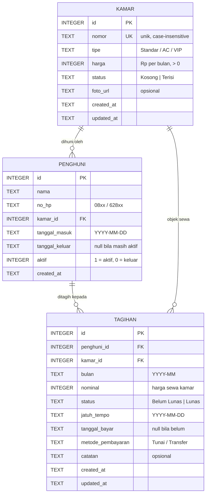

# Skema Database Kamar & Penghuni (WBS 1.1 · EP-01 US-01)

Status: **Draf siap review BA (Dewa)** · Penyusun: DEV BE · DBMS: SQLite (`node:sqlite`)
Migration: [`server/migrations/001_kamar_penghuni.sql`](../server/migrations/001_kamar_penghuni.sql)

## ERD

**Kardinalitas:**
- 1 kamar memiliki 0..N penghuni sepanjang waktu (riwayat), tetapi **maksimal 1 penghuni aktif** pada satu waktu (`ux_penghuni_kamar_aktif`).
- 1 penghuni memiliki 0..N tagihan bulanan (1 tagihan per bulan kalender, dicegah ganda oleh `ux_tagihan_penghuni_bulan`).

## Aturan tagihan bulanan (Sprint 3 · EP-02)

| Kejadian | Aturan | Implementasi |
| :-- | :-- | :-- |
| Generate tagihan bulanan | 1 tagihan per penghuni aktif per bulan dengan nominal = harga kamar | `POST /api/tagihan/generate` + `ux_tagihan_penghuni_bulan` |
| Idempotency tagihan | Tidak ada tagihan ganda untuk penghuni dan bulan yang sama | `UNIQUE (penghuni_id, bulan)` |
| Tanggal jatuh tempo | Dihitung dari tanggal masuk penghuni pada bulan target | Fungsi `hitungJatuhTempo(tanggalMasuk, bulan)` |
| Konfirmasi pembayaran | Status berubah menjadi "Lunas", mencatat tanggal dan metode bayar | `PATCH /api/tagihan/:id/lunas` |
| Pembatalan konfirmasi | Status kembali menjadi "Belum Lunas", tanggal bayar dikosongkan | `PATCH /api/tagihan/:id/batal` |

## Pertanyaan untuk BA / klien

1. Apakah tipe kamar cukup `Standar / AC / VIP`, atau perlu tabel master tipe?
2. Apakah satu kamar bisa dihuni lebih dari satu orang? (Saat ini diasumsikan **tidak**.)
3. Apakah perlu menyimpan data identitas lain (no. KTP, kontak darurat)?

## Checklist persetujuan BA

- [ ] Entitas & atribut sesuai kebutuhan klien
- [ ] Aturan status kamar disetujui
- [ ] Siap di-migrate (otomatis saat `npm run dev`)
