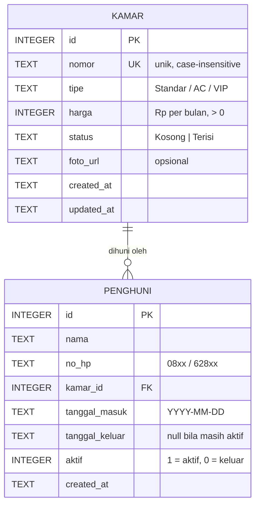

# Skema Database Kamar & Penghuni (WBS 1.1 · EP-01 US-01)

Status: **Draf siap review BA (Dewa)** · Penyusun: DEV BE · DBMS: SQLite (`node:sqlite`)
Migration: [`server/migrations/001_kamar_penghuni.sql`](../server/migrations/001_kamar_penghuni.sql)

## ERD

**Kardinalitas:** 1 kamar memiliki 0..N penghuni sepanjang waktu (riwayat), tetapi **maksimal 1 penghuni aktif** pada satu waktu (unique partial index `ux_penghuni_kamar_aktif`). Setiap penghuni hanya terhubung ke 1 kamar.

## Aturan status kamar

| Kejadian | Aturan | Implementasi |
| :-- | :-- | :-- |
| Kamar baru dibuat | Status awal `Kosong` | `DEFAULT 'Kosong'` |
| Penghuni aktif didaftarkan | Kamar → `Terisi` | trigger `trg_penghuni_masuk` |
| Daftar ke kamar `Terisi` | Ditolak | trigger `trg_penghuni_cek_kamar_kosong` + unique index |
| Penghuni dicatat keluar (`aktif` 1→0) | Kamar → `Kosong` | trigger `trg_penghuni_keluar` |
| Hapus kamar `Terisi` | Ditolak | trigger `trg_kamar_hapus_terisi` |

Aturan dijaga di level database, sehingga tetap konsisten walaupun data diubah di luar API.

## Pemetaan ke acceptance criteria

| Acceptance criteria | Dijamin oleh |
| :-- | :-- |
| Nomor kamar tidak boleh duplikat | `UNIQUE COLLATE NOCASE` + respons 409 |
| Field wajib (nomor, tipe, harga) | `NOT NULL`, `CHECK (harga > 0)` + validasi API (422) |
| Satu penghuni hanya terhubung ke satu kamar aktif | FK `kamar_id` tunggal + unique partial index |
| Setelah simpan, kamar menjadi "Terisi" | trigger `trg_penghuni_masuk` |
| Kamar "Terisi" tidak bisa dipilih | trigger + validasi API (409) + opsi disabled di form |
| Zero-loss data | Penghuni keluar tidak dihapus (soft: `aktif = 0`, `tanggal_keluar`) |

## Kesiapan untuk Sprint berikutnya

- **EP-02 Tagihan:** `kamar.harga` menjadi dasar nominal tagihan; tabel `tagihan` nanti merujuk `penghuni.id` (FK) dan memakai `tanggal_masuk` untuk menghitung jatuh tempo.
- **EP-03 Keluhan:** tabel `keluhan` merujuk `penghuni.id` dan `kamar.id`.

## Pertanyaan untuk BA / klien

1. Apakah tipe kamar cukup `Standar / AC / VIP`, atau perlu tabel master tipe?
2. Apakah satu kamar bisa dihuni lebih dari satu orang? (Saat ini diasumsikan **tidak**.)
3. Apakah perlu menyimpan data identitas lain (no. KTP, kontak darurat)?

## Checklist persetujuan BA

- [ ] Entitas & atribut sesuai kebutuhan klien
- [ ] Aturan status kamar disetujui
- [ ] Siap di-migrate (otomatis saat `npm run dev`)
